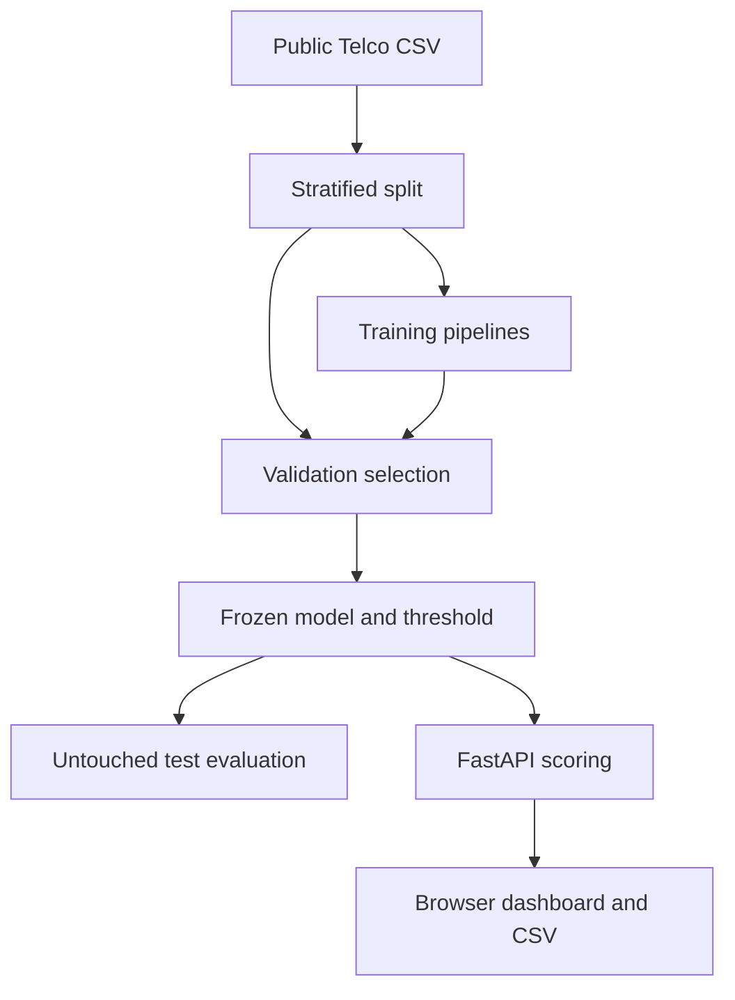

# Churn Compass

A customer churn scoring application that compares a baseline, logistic
regression, and a random forest, then serves the selected model through a
dashboard and a validated batch API.

**Verified result:** 0.833 ROC AUC and 0.625
average precision on 1,409 untouched test customers from
the IBM Telco sample. At the validation-selected threshold of
0.170, precision is 44.9% and recall is
89.8%. These are retrospective dataset results, not live customer
retention improvements.

## Features

- Three reproducible model benchmarks with stratified 60/20/20 splits.
- Preprocessing fitted inside each training pipeline to prevent leakage.
- Validation-only model selection by average precision and threshold selection
  by F2, which puts more weight on recall than precision.
- ROC AUC, average precision, precision, recall, F2, Brier score and confusion
  matrix in a machine-readable evaluation artifact.
- Validation permutation importance, a precision/recall curve, and a held-out
  customer review table.
- Single-customer scoring, batch CSV upload/download, and sample CSV.
- Validation of required fields, numeric ranges, categorical values and batch
  size; responsive interface and OpenAPI documentation.

## Architecture



## Run locally

Use **Python 3.12**. Open a terminal inside this repository.

Windows PowerShell, without changing execution policy:

```powershell
py -3.12 -m venv .venv
.venv\Scripts\python -m pip install -r requirements.txt
.venv\Scripts\python -m app.bootstrap
.venv\Scripts\python -m uvicorn app.main:app --host 127.0.0.1 --port 8000
```

macOS or Linux:

```bash
python3.12 -m venv .venv
.venv/bin/python -m pip install -r requirements.txt
.venv/bin/python -m app.bootstrap
.venv/bin/python -m uvicorn app.main:app --host 127.0.0.1 --port 8000
```

Open **http://127.0.0.1:8000**. Interactive API documentation is at `/docs`.
Stop the server with Ctrl+C. Run the bootstrap once before starting the server;
rerun it when intentionally rebuilding the dataset/model. Restart the server
after rebuilding. First setup requires an internet connection for dependencies
and, where applicable, public dataset downloads. Optional provider API calls also
require internet access.

## Tests

```bash
python -m unittest discover -s tests -v
```

Use the virtual environment's `python` executable above. CI runs these tests on
Python 3.12 without downloading the full source dataset. See `VALIDATION.md`
for the checks actually completed for this release. Dependency versions are
pinned to the tested direct dependencies; this is not a full transitive lockfile.

## Docker

```bash
docker build -t portfolio-app .
docker run --rm -it -p 127.0.0.1:8000:8000 portfolio-app sh -c "python -m app.bootstrap && python -m uvicorn app.main:app --host 0.0.0.0 --port 8000"
```

This portable Docker configuration is included but was not built in the authoring
environment. It rebuilds demo assets at startup. For repeat runs, mount a writable
volume at `/app/artifacts` (and `/app/runtime` for Evidence Desk), owned by the
container's `portfolio` user. Do not expose the service publicly without the
controls in `SECURITY.md`.

## Data and training

Read `DATA_CARD.md` and `MODEL_CARD.md`. The default source is checksum-verified.
To use a compatible local Telco CSV:

```bash
python -m app.bootstrap --csv path/to/telco.csv
```

The target is `Churn`, encoded Yes/No. `customerID` is never a feature. Gender,
SeniorCitizen, Partner and Dependents are excluded from the feature set; this
does not establish fairness. TotalCharges blanks are imputed from training data.

Artifacts are written to `artifacts/`: `model.joblib`, `metrics.json`,
`holdout_scores.csv`, and `split_ids.json`. Raw downloads and the model binary
are ignored by Git. Metrics and split membership are committed for auditability.
Only load model binaries you trained or trust. No resampling is performed across
split boundaries, and the selected model is not refitted on the test set.

## API examples

```bash
curl http://127.0.0.1:8000/api/summary
curl http://127.0.0.1:8000/api/schema
curl -X POST -H "Content-Type: text/csv" --data-binary @examples/customers.csv http://127.0.0.1:8000/api/predict-csv -o predictions.csv
```

`POST /api/predict` accepts `{"customers": [{...feature values...}]}`.
The exact feature names and allowed categories are returned by `/api/schema`.
Use `/docs` to test requests interactively. Batch scoring accepts at most 10,000
rows and 5 MB. Extra input columns, including outcomes, are not used as features.

## Interpretation and next improvements

The low review threshold deliberately produces false positives. It must not be
presented as a profit-optimal intervention policy. There is no evidence that
contacting a flagged customer changes their outcome. Before a real deployment,
collect future cohorts, check calibration and subgroup performance, evaluate
interventions experimentally, and monitor drift. The UI displays feature
associations, not causal explanations or per-customer SHAP attributions.

See `INTERVIEW_GUIDE.md` for a demonstration script and implementation questions.
Software is MIT licensed; source data attribution is separate.
